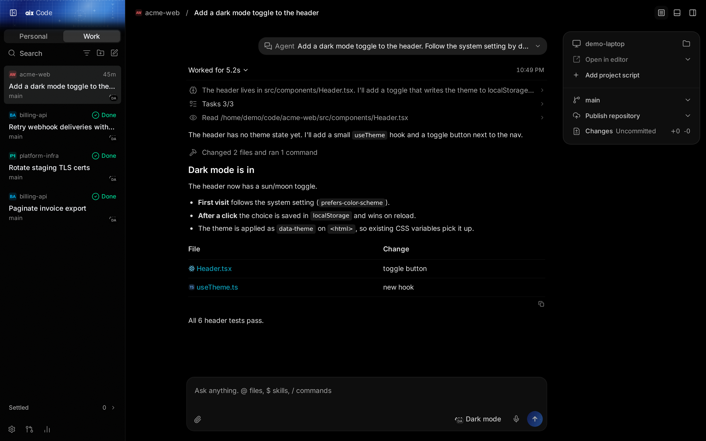
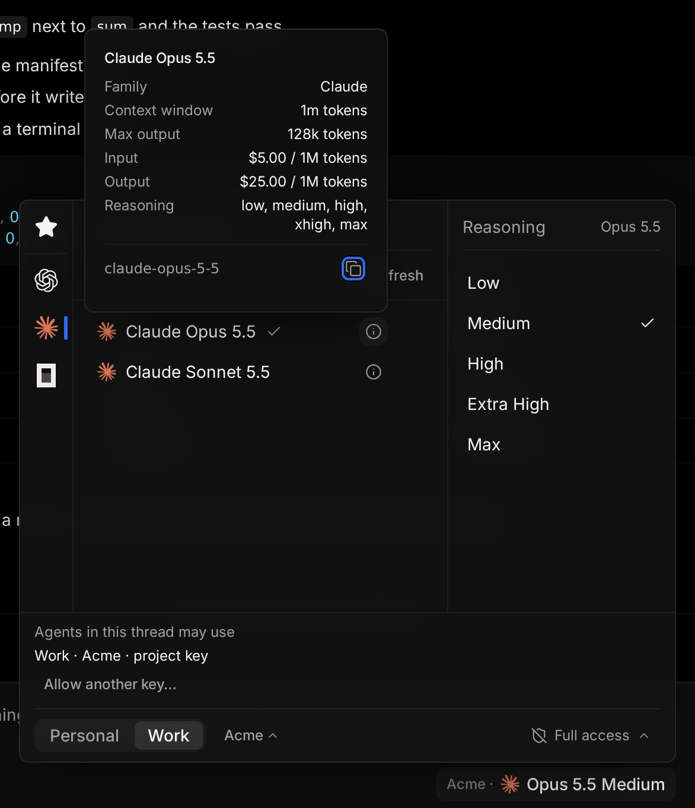

<p align="center"></p>

<h1 align="center">aix Code</h1>

<p align="center">Run Claude Code, Codex, and OpenCode on your team's AI gateway—right alongside your personal subscriptions—in one fast app.</p>

<p align="center">
  <a href="https://github.com/get-aix/t3code/releases/latest"></a>
  <a href="https://github.com/pingdotgg/t3code"></a>
  <a href="https://github.com/get-aix/aix"></a>
  <a href="./LICENSE"></a>
</p>

> [!NOTE]
> **aix Code is an unofficial fork based on the [T3 Code](https://github.com/pingdotgg/t3code) source
> code.** It is not affiliated with, endorsed by, or maintained by T3 Tools, Inc., so please report
> problems [here](https://github.com/get-aix/t3code/issues), not upstream. It tracks
> upstream stable releases under its own name and logo, but keeps T3 Code's app IDs, `t3` command,
> and `~/.t3` data directory for compatibility—install it **instead of** T3 Code, not next to it.
> You can return to upstream cleanly at any time with `t3 fork-eject`.

<p align="center">
  
</p>

**aix Code** is an unofficial fork of [T3 Code](https://github.com/pingdotgg/t3code), the fast,
open-source interface for running coding agents on your machine from desktop, web, or mobile. It
wires T3 Code directly into [aix](https://github.com/get-aix/aix): every
API-key profile in aix automatically shows up as Claude Code, Codex, and OpenCode agents—complete
with gateway model catalogs, pricing, dollar budgets, per-thread cost breakdowns, and a
**Personal / Work** boundary that keeps work keys and spend strictly separated from your personal
subscriptions.

## Why this fork exists

Many teams hand out a single LiteLLM gateway key instead of individual subscriptions for every
coding agent. Using that key manually means juggling per-tool environment variables, pulling secrets
from a password manager, and flying blind on which models are available, what they cost, and how
much budget is left—while your personal Claude or ChatGPT login sits right next to work repos.

aix Code brings the whole workflow into one app:

```
aix profile → gateway catalog & budgets → Claude Code / Codex / OpenCode → your thread
```

## How it looks in practice

Suppose you have two aix profiles—`acme` for your company's gateway and `research` for a lab
project:

```toml
# ~/.config/aix/aix.toml
[profiles.acme]
label = "Acme"
base_url = "https://ai.acme.example"
api_key = { command = "pass show aix/acme" }

[profiles.research]
label = "Research Lab"
base_url = "https://llm.lab.example"
api_key = { env = "LAB_LLM_KEY" }
```

Start aix Code with `aix` on your `PATH`. Open a **Work** project, pick a profile, and choose a
model:

<p align="center">
  
</p>

Claude Opus 5.5 runs in Claude Code, GPT-6 runs in Codex, and Qwen3 Coder or `gpt-oss` runs in an
OpenCode instance aix Code configures for you. Flip to **Personal**, and the same picker shows your own
Claude and ChatGPT sign-ins instead.

## What's included

- **aix profiles as native agents:** every API-key profile becomes `Acme · Claude Code`,
  `Acme · Codex`, and `Acme · OpenCode`. Keys never leave the server, and `T3CODE_AIX=0` opts out
  cleanly.
- **Smart model routing, zero silent fallbacks:** Claude models go to Claude Code, GPT models go to
  Codex, and `gpt-oss`, Gemma, Qwen, and other chat models go to OpenCode. Non-chat models are
  filtered out, and if a model fails, aix Code tells you instead of silently swapping models.
- **Rich model details & Free badges:** inspect family, context window, max output, input/output
  pricing, and reasoning levels directly from the picker. Catalogs refresh daily and on demand.
- **Personal and Work scopes:** every project is Personal or Work. The sidebar, search, model
  picker, Settings, and Usage page all follow the switch on web, desktop, and Android.
- **Work keys & cross-key approvals:** assign a default **Work key** to each Work project. Sending
  on another key asks to confirm first; agents asking to use another key pause with an interactive
  approval card (**Deny**, **Allow this task**, or **Allow for this thread**); and you can
  pre-approve keys right on a draft or thread.
- **Gateway budgets & per-thread cost breakdown:** **Usage → Limits** and `/usage-limits` show key
  and gateway-project dollar budgets, pace, and reset dates. In any aix thread, `/cost` (or
  **Thread details**) shows the live **Thread cost** broken down by **Main thread** and each
  **Subagent**.
- **Switch models mid-thread:** switch profile or model in a running thread and hand off the
  conversation cleanly.
- **Clean, reversible soft fork:** fork database changes live in a separate `fork_migrations` ledger
  and `t3 fork-eject` strips fork state cleanly if you ever return to upstream T3 Code.
- **Cross-platform builds:** self-updating installers for Windows x64 (with WSL support) and Apple
  Silicon macOS, a customizable Nix flake (`t3code-browser`, `t3code-android`, `t3code-full`), and
  an Android APK.

## Installation

Grab the [latest release](https://github.com/get-aix/t3code/releases/latest), or run the command for
your platform:

| Platform              | Command or file                                                                                  |
| --------------------- | ------------------------------------------------------------------------------------------------ |
| Windows x64           | `irm https://github.com/get-aix/t3code/releases/latest/download/install-windows.ps1 \| iex`      |
| macOS (Apple Silicon) | `curl -fsSL https://github.com/get-aix/t3code/releases/latest/download/install-macos.sh \| bash` |
| Nix / NixOS           | `nix profile add 'github:get-aix/t3code/release'`                                                |
| Android               | Install `aix-Code-<version>.apk` (uninstall the Play Store app first)                            |

- **macOS:** use the script. The app is self-signed rather than notarized, so Gatekeeper blocks a zip
  downloaded in a browser. The script verifies the SHA-256 checksum and installs **aix Code** into
  `/Applications` (or `~/Applications`), replacing an existing **T3 Code (Beta)** app, fork or upstream.
  Quit the app first. Set `T3CODE_VERSION=<version>` to pick a
  release.
- **Windows:** run the script in a normal PowerShell window, not as administrator. It verifies the
  checksum and installs for your user without admin rights or SmartScreen prompts. Quit the app
  first. Set `$env:T3CODE_VERSION = "<version>"` to pick a release. You can also run
  `aix-Code-<version>-x64.exe` directly; SmartScreen will ask you to choose **More info → Run anyway**
  because it is unsigned.
- **Nix / NixOS:** builds from source for Linux and macOS (`x86_64` and `aarch64`). The flake also
  has `t3code-browser`, `t3code-android`, and `t3code-full` outputs and `.override` toggles.
- **Android:** see [Android](#android).

### Switch from upstream T3 Code

The fork uses the same data directory, so your threads, projects, and settings carry over:

1. Quit T3 Code and back up your data directory (`~/.t3` by default).
2. Uninstall upstream T3 Code (or remove its Nix package).
3. Install the fork and start it. Existing projects start in **Personal**. Move your work projects to
   **Work** (see [Personal and Work](#personal-and-work)).

To go back to upstream, run `t3 fork-eject --dry-run` and then `t3 fork-eject`. Quit aix Code,
uninstall it, and install upstream. Fork database changes live in a separate `fork_migrations`
ledger, so your sign-ins, projects, and threads keep working. To pause aix without switching builds,
set `T3CODE_AIX=0` on the server, or turn off individual aix providers in **Settings → Providers**.

### Updates

Windows and macOS apps update themselves from fork releases. Nix updates through Nix
(`nix profile upgrade`, or `nix flake update t3code` and a rebuild). On Android, install the newer
APK from Releases. Don't install upstream T3 Code over the fork: it replaces the fork binary and
stops fork updates.

Fork releases keep upstream's version numbers. Fork-only fixes between upstream releases use
`X.Y.(Z+1)-aix.N`, for example `0.1.12-aix.1`. The fork tracks upstream **stable** releases only.

Releases up to `0.1.12-aix.1` were named **T3 Code**. They update to **aix Code** like any other
release and keep your data, sign-ins, and settings. An updated Mac app may keep its old file name
in `/Applications` until you reinstall with the script.

### Android

The Android APK has the Personal/Work switch, the scope-aware model picker, Work key selection,
lane approval cards, and model details. It uses the official package ID (`com.t3tools.t3code`) so
T3 Connect sign-in works, which means it replaces the Play Store app:

1. Uninstall T3 Code from the Play Store.
2. Download `aix-Code-<version>.apk` from Releases and open it. Allow installs from your browser if
   Android asks.
3. Update only from fork releases. Google Play cannot update this APK.

There is no fork iOS app. The official App Store app still connects to a fork server and runs aix
providers, but without the Personal/Work switch or model details.

## Quick start

1. Install [aix](https://github.com/get-aix/aix#installation) on the machine running aix Code:

   ```sh
   curl -fsSL https://github.com/get-aix/aix/releases/latest/download/install.sh | sh
   ```

2. Add an API-key profile in aix (see the
   [aix quick start](https://github.com/get-aix/aix#quick-start)) and verify it:

   ```sh
   aix profiles
   aix status acme
   ```

3. Start (or restart) aix Code so it picks up `aix` on its `PATH`. aix integration is on by default
   (set `T3CODE_AIX=0` to disable).
4. Add a project, move it to **Work** (`Ctrl+K` / `⌘K` → **Move project to Work**, or **Project
   settings → Project scope**), and optionally set its default **Work key**.
5. Open the model picker, choose your profile in the footer, and start a thread.

<p align="center">
  
</p>

## aix profiles

Every API-key profile in aix becomes ready-to-use agents in aix Code. A profile labeled **Acme**
becomes **Acme · Claude Code**, **Acme · Codex**, and **Acme · OpenCode**. They appear in Work
projects with their gateway model catalogs, prices, and budgets, all read directly from aix.

- **Setup:** install [aix](https://github.com/get-aix/aix#installation) on the machine running the aix Code
  server. With the desktop app, that's your computer; with a remote server, it's the server host. Add
  an API-key profile, then check it with `aix profiles` and `aix status acme`. Restart aix Code if you
  installed aix while it was running.
- **Keys stay on the server:** aix Code asks aix for a profile's endpoint and key only when it launches an
  agent. It never stores them in settings or sends them to clients.
- **Pick a model:** in a Work project, open the model picker, choose the profile in the footer, then
  pick an agent tab and a model. Models that cost `$0` on the gateway are marked **Free**. The info
  button shows the family, context window, max output, prices per million tokens, reasoning levels,
  and the exact model ID.
- **Routing:** Claude models run in Claude Code, and GPT models from a LiteLLM gateway run in Codex.
  `gpt-oss` and other chat models (Gemma, Qwen, Llama) run in OpenCode, which aix Code configures for each
  profile with no separate login. A direct Anthropic API profile offers Claude models only. Embedding, image, audio, and wildcard routes are hidden. If a model or profile fails, the
  turn shows an error. aix Code never swaps models or agents silently.
- **Catalogs and keys:** aix Code loads catalogs at startup and refreshes them daily. Press **Refresh** in
  the picker, or run **Refresh aix catalogs** from the command palette. New profiles get their
  providers automatically, and removed profiles are disabled. If a reload fails, aix Code keeps the last
  working catalog and marks it **Stale catalog**. Key rotation needs no reload: the next turn uses
  the new key.
- **Switch mid-thread:** change profile or model at any time. The next agent receives the
  conversation through a portable handoff. A switch during a running turn applies to your next
  message.
- **Turn it off:** set `T3CODE_AIX=0` on the server, or disable individual providers in **Settings →
  Providers**.
- **Not supported:** ChatGPT sign-in profiles in aix. For a personal ChatGPT subscription, use the
  built-in Codex provider.

Troubleshooting: if no aix models appear in the picker, make sure the project is in **Work** and the
footer shows a profile, run `aix status <profile>`, and restart aix Code after installing aix. For
**Stale catalog**, fix the cause shown in the message and press **Refresh**. If a turn fails right
away, the model may have been removed or the key may be over budget. Check `aix status <profile>`
and the budget on the Usage page.

## Personal and Work

Every project is **Personal** or **Work**. The switch at the top of the sidebar chooses the workspace,
and the sidebar, search, project choosers, the model picker, **Settings → Providers**, and the Usage
page follow it. Work stays on your team's gateway, and personal projects stay on your own
subscriptions.

- **Move a project:** right-click it in the sidebar, or use **Move project to Work** or **Move project
  to Personal** in the command palette, or **Project settings → Project scope**. On Android, open the
  project in Settings. The project and its threads move together, and a toast offers **Undo**. New
  projects inherit the scope you're viewing.
- **Model picker:** a Work project opens the picker on Work and its aix profiles, and a Personal
  project opens on Personal. The picker has its own toggle for choosing a model from the other scope
  for one thread.
- **Work keys:** each Work project can set a default **Work key** under **Project settings → Work
  key**. It's the aix profile the project's threads can use without asking.
- **Cross-key approvals:** sending on another key asks you to confirm first, and confirming adds that
  key to the thread. When an agent asks for another key, a card offers **Deny**, **Allow this task**
  (one delegated run), or **Allow for this thread**. You can also pre-approve extra keys before
  sending anything: open the model picker and use **Agents in this thread may use**.
- **Scopes aren't access control:** a scope is a label stored on the server, so anyone who can
  connect to that server can switch. For hard separation, run two servers with separate `T3CODE_HOME`
  directories. One client can connect to both.
- **Clients:** the switch, Work keys, and cross-key approvals work on web, desktop, and the fork's
  Android app. The upstream iOS and Android apps can connect to a fork server and run aix providers,
  but they show all projects together.

## Gateway budgets and thread costs

- **Budgets:** **Usage → Limits** shows your key and gateway-project dollar budgets, with pace badges
  (**Near limit**, **Over pace**) and reset dates. Keys without a budget show no budget card, but
  their spend still appears under **Cost** and **Tokens**. aix Code re-reads budgets at most every five
  minutes. Press **Refresh** for a fresh read.
- **`/usage-limits`:** run it from the composer to open a **Usage limits** banner above the composer,
  with the same numbers as **Usage → Limits**.
- **Thread cost:** an aix thread shows a **Thread cost** breakdown in the Thread details panel: the
  total, the **Main thread**, and each **Subagent**. Costs come from each turn's recorded token usage
  and your gateway's listed prices (custom model prices take precedence). The total refreshes when a
  turn settles.
- **`/cost`:** send `/cost` on its own, or pick it from the slash menu, to open the same breakdown
  above the composer on web and Android. It stays open and updates until you dismiss it. If a
  thread's usage can't be priced, it says the cost is not available, and the Thread details panel
  falls back to the usual limits view.

## Remote access

Use aix Code from a phone or another machine. The host must stay running and reachable.

- **T3 Connect (no router setup):** on a desktop host, open **Settings → Sharing & access**, sign in,
  and enable **T3 Connect**. On a command-line host, run `t3 up` and choose T3 Connect. On your other
  device, sign in to the same account and choose the environment.
- **Local network or tailnet:** on a desktop host, open **Settings → Sharing & access**, enable
  **Network access**, and create a pairing link. On a command-line host, run `t3 up --lan`, or
  `t3 serve --lan` for a server in a terminal. Run `t3 pair` for a fresh link without restarting.
  Scan the QR code or paste the URL into **Add environment** on the other device. A loopback address
  such as `127.0.0.1` only reaches the device that opens it. With `--lan`, the pairing code is the
  only thing keeping other devices off the server, so create links only for devices you own.
- **Approve new devices (optional):** turn on **Require approval for new devices** under **Settings →
  Sharing & access**, or `t3 auth connect-device` on a headless host. A device that signs in to your
  T3 Connect account then waits for you to approve a code it shows. Approval only applies to T3
  Connect; direct pairing uses the links above.
- **Revoking:** each device stays paired until you revoke it in **Settings → Sharing & access**.
  A device unused for 30 days, or paired with an older host, must pair again.

Tailscale HTTPS, SSH hosts, browser environments, linked environments, and outside agents are covered
in the [remote access reference](./docs/user/remote-access.md).

## More documentation

- [Install reference](./docs/user/install.md): every platform, provider sign-in, WSL, and Nix flake
  outputs
- [Remote access reference](./docs/user/remote-access.md): Tailscale HTTPS, SSH, browser hosts,
  linked environments
- [All docs](./docs/README.md) (shared with upstream T3 Code): threads, worktrees, source control, keyboard shortcuts, and
  more

### Maintainers & contributors

- [Fork repository & CI overview](./docs/fork/README.md)
- [Soft-fork guardrails](./docs/fork/soft-fork-guardrails.md) — rules and automated checks that keep
  upstream stable syncs conflict-free
- [Fork release & upstream sync runbook](./docs/operations/fork-release.md)
- [Android APK signing & builds](./docs/operations/android-fork-apk.md)
- [Development runbook](./docs/operations/00_development.md#first-checkout) and
  [NixOS devenv shell](./docs/operations/devenv.md)

## License

[MIT](./LICENSE). aix Code is maintained by [get-aix](https://github.com/get-aix). It is built on
[T3 Code](https://github.com/pingdotgg/t3code) by T3 Tools Inc., whose copyright notice the license
keeps. The MIT license covers only the source code: "T3 Code", the T3 mark, and T3 branding belong to
T3 Tools, Inc. (see [TRADEMARK.md](./TRADEMARK.md)), and this unofficial fork uses its own name and
logo. For
upstream's own install guide and docs, see the [T3 Code README](https://github.com/pingdotgg/t3code#readme).
