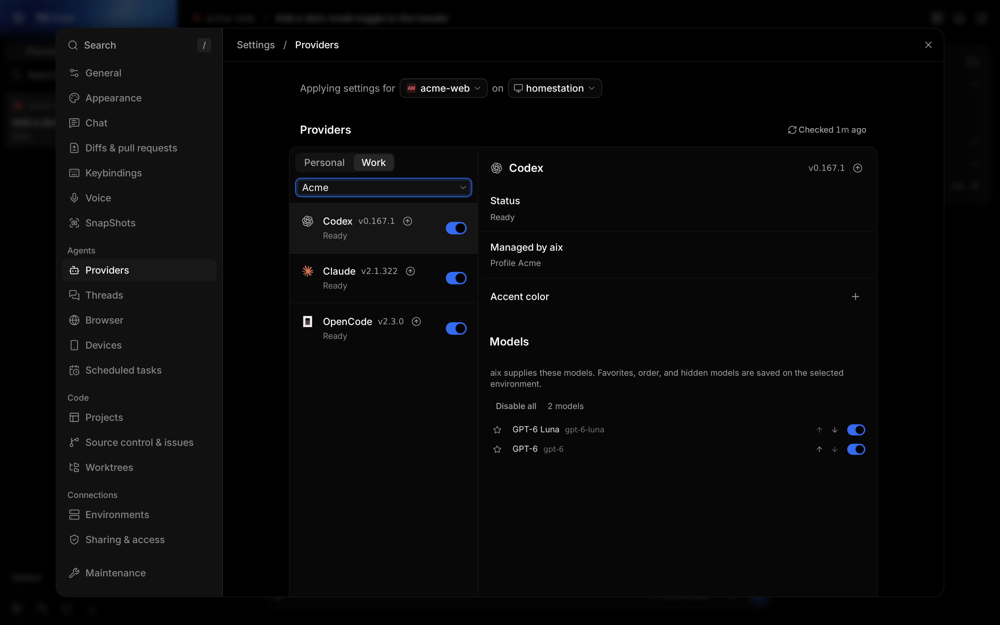

<p align="center"></p>

<h1 align="center">T3 Code with aix</h1>

<p align="center">Run Claude Code, Codex, and OpenCode on your team's AI gateway—right alongside your personal subscriptions—in one fast app.</p>

<p align="center">
  <a href="https://github.com/get-aix/t3code/releases/latest"></a>
  <a href="https://github.com/pingdotgg/t3code"></a>
  <a href="https://github.com/get-aix/aix"></a>
  <a href="./LICENSE"></a>
</p>

> [!NOTE]
> **This is a community soft fork, not the official T3 Code.** It tracks
> [pingdotgg/t3code](https://github.com/pingdotgg/t3code) stable releases and uses the same app name
> and `~/.t3` data directory—install it **instead of** T3 Code, not next to it. You can return to
> upstream cleanly at any time with `t3 fork-eject`.

<p align="center">
  
</p>

**T3 Code** is a fast, open-source interface for running coding agents on your machine from desktop,
web, or mobile. This fork wires it directly into [aix](https://github.com/get-aix/aix): every
API-key profile in aix automatically shows up as Claude Code, Codex, and OpenCode agents—complete
with gateway model catalogs, pricing, dollar budgets, per-thread cost breakdowns, and a
**Personal / Work** boundary that keeps work keys and spend strictly separated from your personal
subscriptions.

## Why this fork exists

Many teams hand out a single LiteLLM gateway key instead of individual subscriptions for every
coding agent. Using that key manually means juggling per-tool environment variables, pulling secrets
from a password manager, and flying blind on which models are available, what they cost, and how
much budget is left—while your personal Claude or ChatGPT login sits right next to work repos.

This fork brings the whole workflow into T3 Code:

```
aix profile → gateway catalog & budgets → Claude Code / Codex / OpenCode → your thread
```

## How it looks in practice

Suppose you have two aix profiles—`acme` for your company's gateway and `research` for a lab
project:

```toml
# ~/.config/aix/aix.toml
[profiles.acme]
label = "Acme"
base_url = "https://ai.acme.example"
api_key = { command = "pass show aix/acme" }

[profiles.research]
label = "Research Lab"
base_url = "https://llm.lab.example"
api_key = { env = "LAB_LLM_KEY" }
```

Start T3 Code with `aix` on your `PATH`. Open a **Work** project, pick a profile, and choose a
model:

<p align="center">
  
</p>

Claude Opus 5.5 runs in Claude Code, GPT-6 runs in Codex, and Qwen3 Coder or `gpt-oss` runs in an
OpenCode instance T3 configures for you. Flip to **Personal**, and the same picker shows your own
Claude and ChatGPT sign-ins instead.

## What's included

- **aix profiles as native agents:** every API-key profile becomes `Acme · Claude Code`,
  `Acme · Codex`, and `Acme · OpenCode`. Keys never leave the server, and `T3CODE_AIX=0` opts out
  cleanly.
- **Smart model routing, zero silent fallbacks:** Claude models go to Claude Code, GPT models go to
  Codex, and `gpt-oss`, Gemma, Qwen, and other chat models go to OpenCode. Non-chat models are
  filtered out, and if a model fails, T3 tells you instead of silently swapping models.
- **Rich model details & Free badges:** inspect family, context window, max output, input/output
  pricing, and reasoning levels directly from the picker. Catalogs refresh daily and on demand.
- **Personal and Work scopes:** every project is Personal or Work. The sidebar, search, model
  picker, Settings, and Usage page all follow the switch on web, desktop, and Android.
- **Work keys & cross-key approvals:** assign a default **Work key** to each Work project. Sending
  on another key asks to confirm first; agents asking to use another key pause with an interactive
  approval card (**Deny**, **Allow this task**, or **Allow for this thread**); and you can
  pre-approve keys right on a draft or thread.
- **Gateway budgets & per-thread cost breakdown:** **Usage → Limits** and `/usage-limits` show key
  and gateway-project dollar budgets, pace, and reset dates. In any aix thread, **Thread details**
  displays the live **Thread cost** broken down by **Main thread** and each **Subagent**.
- **Switch models mid-thread:** switch profile or model in a running thread and hand off the
  conversation cleanly.
- **Clean, reversible soft fork:** fork database changes live in a separate `fork_migrations` ledger
  and `t3 fork-eject` strips fork state cleanly if you ever return to upstream T3 Code.
- **Cross-platform builds:** self-updating installers for Windows x64 (with WSL support) and Apple
  Silicon macOS, a customizable Nix flake (`t3code-browser`, `t3code-android`, `t3code-full`), and
  an Android APK.

## Installation

Grab the [latest release](https://github.com/get-aix/t3code/releases/latest):

| Platform              | Command or file                                                                                  |
| --------------------- | ------------------------------------------------------------------------------------------------ |
| Windows x64           | `irm https://github.com/get-aix/t3code/releases/latest/download/install-windows.ps1 \| iex`      |
| macOS (Apple Silicon) | `curl -fsSL https://github.com/get-aix/t3code/releases/latest/download/install-macos.sh \| bash` |
| Nix / NixOS           | `nix profile add 'github:get-aix/t3code/release'`                                                |
| Android               | Install `T3-Code-<version>.apk` (uninstall the Play Store app first)                             |

- **macOS:** use the script above—because the app is self-signed rather than notarized, Gatekeeper
  blocks zips downloaded in a browser. The script verifies the SHA-256 checksum and installs **T3
  Code** into `/Applications`.
- **Windows:** run the script in a regular (non-admin) PowerShell window to verify the checksum and
  install for your user without SmartScreen prompts.
- **Updates:** desktop apps update automatically from fork releases; Nix updates via Nix. There is
  no fork iOS app (the official App Store app still connects to a fork server).

See [Install and update the fork](./docs/user/fork.md#install) for full details, including switching
from—or back to—upstream T3 Code.

## Quick start

1. Install [aix](https://github.com/get-aix/aix#installation) on the machine running T3 Code:

   ```sh
   curl -fsSL https://github.com/get-aix/aix/releases/latest/download/install.sh | sh
   ```

2. Add an API-key profile in aix (see the
   [aix quick start](https://github.com/get-aix/aix#quick-start)) and verify it:

   ```sh
   aix profiles
   aix status acme
   ```

3. Start (or restart) T3 Code so it picks up `aix` on its `PATH`. aix integration is on by default
   (set `T3CODE_AIX=0` to disable).
4. Add a project, move it to **Work** (`Ctrl+K` / `⌘K` → **Move project to Work**, or **Project
   settings → Project scope**), and optionally set its default **Work key**.
5. Open the model picker, choose your profile in the footer, and start a thread.

<p align="center">
  
</p>

## Documentation

### User guides

| Guide                                                        | What it covers                                                                        |
| ------------------------------------------------------------ | ------------------------------------------------------------------------------------- |
| [aix profiles](./docs/user/aix-profiles.md)                  | Setup, model routing, model details, catalog refresh, key rotation, mid-thread switch |
| [Personal and Work](./docs/user/work-personal.md)            | Project scopes, Work keys, cross-key approval cards, pre-approving keys on drafts     |
| [Gateway budgets & thread costs](./docs/user/aix-budgets.md) | Usage → Limits, gateway project budgets, `/usage-limits`, per-thread cost breakdown   |
| [The fork](./docs/user/fork.md)                              | Install, updates, Android APK, `t3 fork-eject`, running from source, full changelog   |
| [Install T3 Code](./docs/user/install.md)                    | Every platform, provider sign-in, WSL, Nix flake outputs and `.override` toggles      |
| [Remote access](./docs/user/remote-access.md)                | Use T3 Code from a phone or another machine                                           |
| [All T3 Code docs](./docs/README.md)                         | Threads, worktrees, source control, keyboard shortcuts, and more                      |

### Maintainers & contributors

- [Fork repository & CI overview](./docs/fork/README.md)
- [Soft-fork guardrails](./docs/fork/soft-fork-guardrails.md) — rules and automated checks that keep
  upstream stable syncs conflict-free
- [Fork release & upstream sync runbook](./docs/operations/fork-release.md)
- [Android APK signing & builds](./docs/operations/android-fork-apk.md)
- [Development runbook](./docs/operations/development.md#first-checkout) and
  [NixOS devenv shell](./docs/operations/devenv.md)

## License

[MIT](./LICENSE). T3 Code is created by [pingdotgg](https://github.com/pingdotgg/t3code).

## Original T3 Code README

The following is the complete upstream README from [`pingdotgg/t3code` revision `59651c1761`](https://github.com/pingdotgg/t3code/commit/59651c1761) (`v0.1.11`). Its install and download links are for **original T3 Code**, not this fork.

<details>
<summary>Show the full upstream README</summary>

<!-- prettier-ignore-start -->
<p align="center">
  <a href="https://t3.codes">
    
  </a>
</p>

<h1 align="center">T3 Code</h1>

<p align="center">The open-source control plane for coding agents.</p>

<p align="center">
  <a href="https://t3.codes/download"><strong>Download</strong></a> ·
  <a href="https://apps.apple.com/us/app/t3-code-remote-claude-more/id6787819824">iOS</a> ·
  <a href="https://play.google.com/store/apps/details?id=com.t3tools.t3code">Android</a> ·
  <a href="https://app.t3.codes">Web</a> ·
  <a href="./docs/README.md">Docs</a> ·
  <a href="https://discord.gg/jn4EGJjrvv">Discord</a>
</p>

<p align="center">
  <a href="https://t3.codes">
    
  </a>
</p>

T3 Code runs the coding agents on your machine and gives them one fast interface. Start a thread at your desk, then approve the next step from your phone.

It works with Claude Code, Codex, Cursor, OpenCode, Grok Build, Antigravity, Kiro, Pi, Muse Code, fx, and any [ACP](./docs/user/providers-acp.md) agent. If an agent is set up on your computer, T3 Code can control it.

## What you get

- **Your subscriptions.** T3 Code does not resell tokens. It drives the agents you are already signed in to.
- **Every agent in one place.** Change models in the middle of a thread. Let Claude hand a task to Codex.
- **Desktop, web, and phone.** One server, and every client shows the same threads. There are apps for iOS and Android.
- **Remote ready.** Run agents on any machine. Connect over your local network, Tailscale, or [T3 Connect](./docs/user/remote-access.md).
- **Git built in.** Each thread can work in its own worktree. Review the diff, then commit, push, and open a pull request with one button.
- **Fast.** Performance is a feature here. We measure it, and we treat a dropped frame as a bug.
- **Open.** MIT licensed. If you don't like something, fork it.

## Install

### Desktop app

[Download T3 Code](https://t3.codes/download) for macOS, Windows, or Linux. You can also use a package manager:

| Platform       | Command                                                              |
| -------------- | -------------------------------------------------------------------- |
| macOS          | `brew install --cask t3-code`                                        |
| Windows        | `winget install T3Tools.T3Code` or `scoop install extras/t3code`     |
| Arch Linux     | `yay -S t3code-bin`                                                  |
| Nix            | `nix profile add github:NixOS/nixpkgs/nixos-unstable#t3code`         |
| Debian, Ubuntu | `.deb` from [Releases](https://github.com/pingdotgg/t3code/releases) |

### Command line

This installs the `t3` command. Run `t3` to start the server and open the web app.

```bash
curl -fsSL https://t3.codes/install.sh | sh
```

On Windows, in PowerShell:

```powershell
irm https://t3.codes/install.ps1 | iex
```

To try it once without an install, run `npx t3@latest`.

### Phone

Get the app from the [App Store](https://apps.apple.com/us/app/t3-code-remote-claude-more/id6787819824) or [Google Play](https://play.google.com/store/apps/details?id=com.t3tools.t3code). Then follow [remote access](./docs/user/remote-access.md) to connect it to your computer.

### Sign in to an agent

T3 Code needs one agent that is installed and signed in. For example, install [Claude Code](https://claude.com/product/claude-code) and run `claude auth login`, or install [Codex CLI](https://developers.openai.com/codex/cli) and run `codex login`.

[Provider setup](./docs/user/install.md#providers) has the steps for each agent. [Install T3 Code](./docs/user/install.md) covers nightly builds, AppImage, WSL, and NixOS.

## "Wait, what are you selling me?"

Nothing. We built T3 Code because we wanted the best possible development experience with agents. We were inspired by existing solutions like the Codex desktop app, Conductor, Claude Desktop and Cursor Glass, but none met our bar.

We wanted something performant, remote-ready, and truly open. If we ever go the wrong direction, we want you to have everything you need to fork and build the tool that you want.

## Documentation

- [Install and first run](./docs/user/install.md)
- [Remote access from a phone or another machine](./docs/user/remote-access.md)
- [Permission modes](./docs/user/permission-modes.md)
- [Source control](./docs/user/source-control.md)
- [Connect outside agents over MCP](./docs/user/outside-agents.md)
- [FAQ](./docs/user/faq.md)

[All docs](./docs/README.md) has the full list.

## Contributing

We have limited review capacity. Small, focused fixes are the most likely to be merged. Features need an approved discussion first.

- Read [CONTRIBUTING.md](./CONTRIBUTING.md) before you report a bug or open a pull request.
- Put feature requests in [Ideas](https://github.com/pingdotgg/t3code/discussions/categories/ideas).
- Build from source with the [development runbook](./docs/operations/development.md#first-checkout). The [architecture overview](./docs/internals/overview.md) explains how it works.
- Get help in [Discord](https://discord.gg/jn4EGJjrvv).

## License

[MIT](./LICENSE)

<!-- prettier-ignore-end -->

</details>
