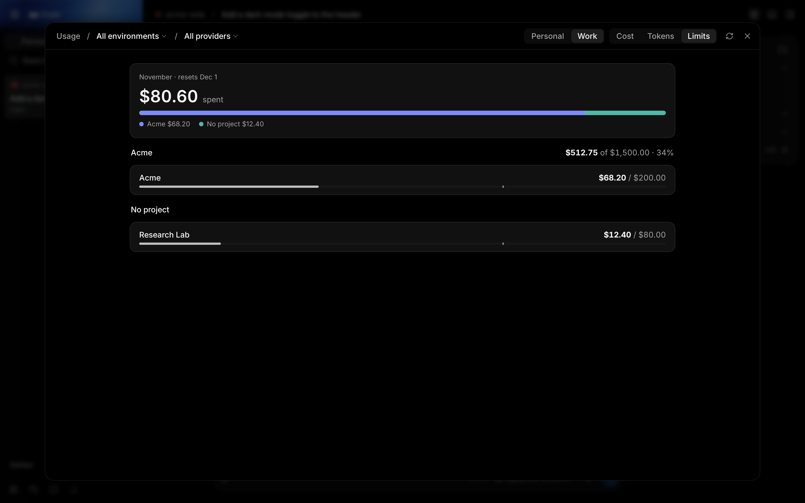

# Gateway budgets and thread costs

When your AI gateway assigns a dollar budget to an [aix profile](./aix-profiles.md)'s key, aix Code
reads it through `aix spend` and shows what you've spent, how much is left, and when the budget
resets—right alongside your team's shared gateway project budget. For threads running on an aix
profile, aix Code also shows a live dollar breakdown of the thread and its subagents.

  

## See your gateway budgets

1. Open **Usage** from the bottom of the sidebar.
2. Select **Limits**.
3. If you have usage in both scopes, switch to **Work**.

The summary card at the top shows the current month, the earliest reset date across your keys, and
your combined Work spend, with a stacked bar breaking that spend down by gateway project.

Below the card, keys are grouped by gateway project:

- **Project heading:** shows the shared project budget (for example, **$512.75 of $1,500.00 · 34%**).
  That total reflects everyone's spend on the project, not just yours.
- **Key card:** shows your key's spend and budget (for example, **$68.20 / $200.00**) with a
  progress bar. The tick mark on the bar shows where even daily spending would put you today.
- **Pace badges:** **Near limit** flags a key close to its cap, and **Over pace** flags one
  spending faster than the period allows.
- **No project:** groups keys that aren't tied to a gateway project.

If the gateway doesn't report a project name, the group is named after the key that spent the most.

## When budgets reset

Each key displays the reset timestamp reported by the gateway. If a gateway only reports when the
budget period began, aix Code assumes a monthly reset. The summary card at the top shows the earliest
reset date across all of your Work keys.

## See what a thread cost

Threads running on an aix profile replace the subscription limit bars in the **Thread details**
panel with a **Thread cost** section:

- The top row shows the thread's total calculated cost in USD.
- Expand **Details** to see the split between the **Main thread** and each **Subagent**.
- Costs are calculated from recorded turn token usage using the prices your gateway lists for each
  model (your custom model prices still take precedence).
- The total refreshes automatically whenever a turn settles.

If any turn in the thread has usage that cannot be priced, aix Code falls back to the regular limits
view instead of showing an incomplete total.

Send `/cost` on its own, or pick it from the composer's slash menu, to open the same breakdown
above the composer on web and Android. It stays open and updates until you dismiss it; on a thread
whose usage cannot be priced, it says the cost is not available.

## Check budgets from a thread

Run `/usage-limits` from the composer's slash menu to check your budgets without leaving the
conversation. A **Usage limits** banner opens above the composer:

- In a Work thread, it names the thread's gateway project or key, **Work**, and the reset date,
  listing the thread's own key first followed by other keys in the same project.
- When you have limits in both scopes, the banner shows a **Personal / Work** toggle so you can
  check either side.

The banner uses the same reading as **Usage → Limits** and closes when you dismiss it or send your
next message. To keep limits always visible, turn on **Usage limits** in **Settings → Appearance →
Thread details**. See [Usage and limits](./usage.md#track-subscription-limits) for how limits work
for your personal subscriptions.

## Personal and Work on the Usage page

The Usage page attributes Codex and Claude usage from Work projects to **Work**, and everything else
to **Personal**. **Cost** and **Tokens** follow the same split. The Personal/Work toggle only
appears when both scopes have usage.

## Keys without a budget

A gateway key without a configured budget (or a direct Anthropic API profile) shows no budget card
under **Limits**, though its tokens and costs still appear under **Cost** and **Tokens**.

If a budget looks stale, press **Refresh** on **Usage → Limits**. On its own, aix Code re-reads
budgets at most every five minutes (backed by aix's own cache).
