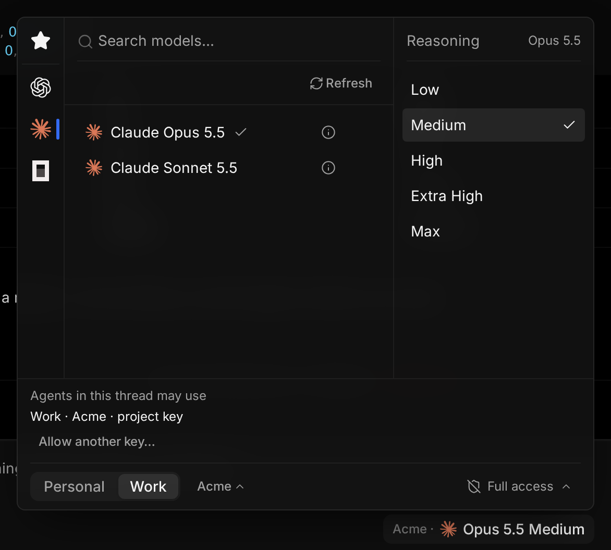
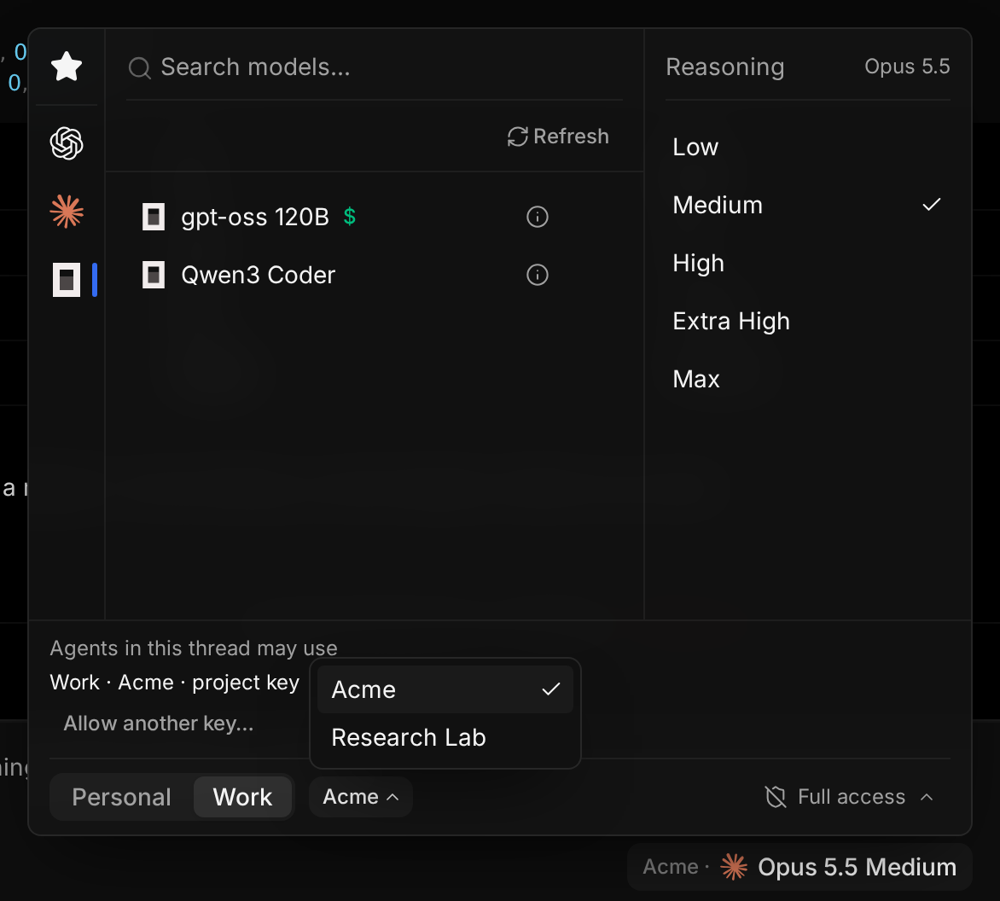
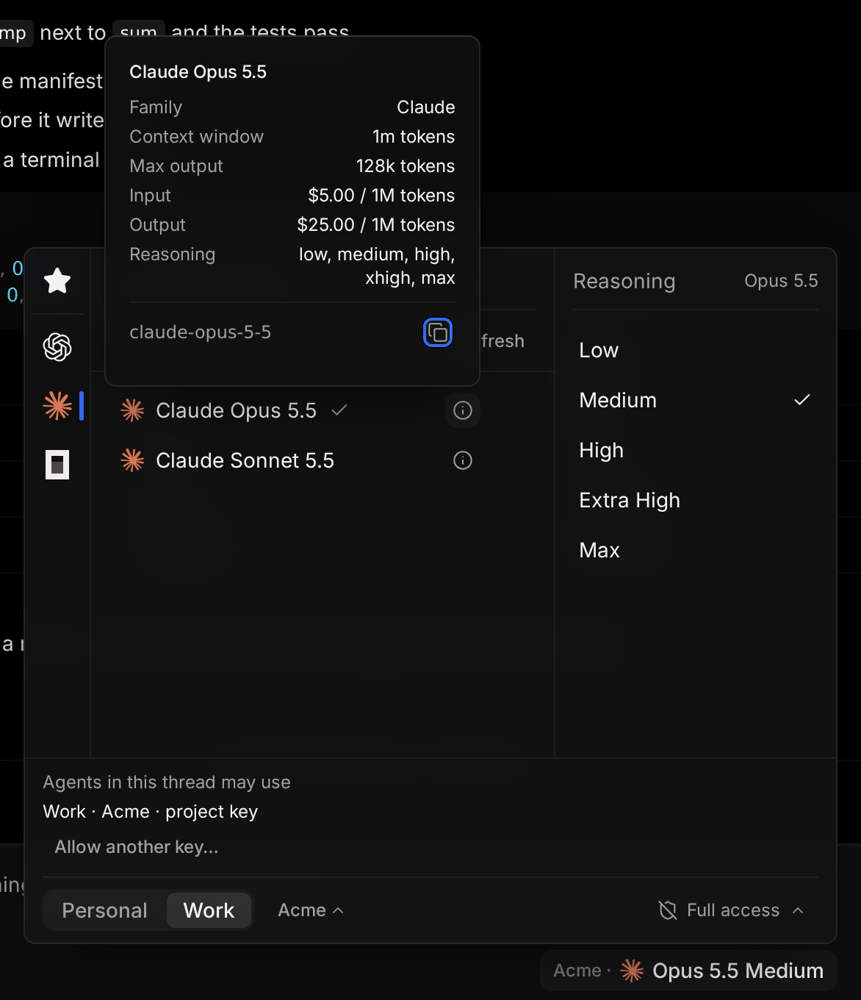
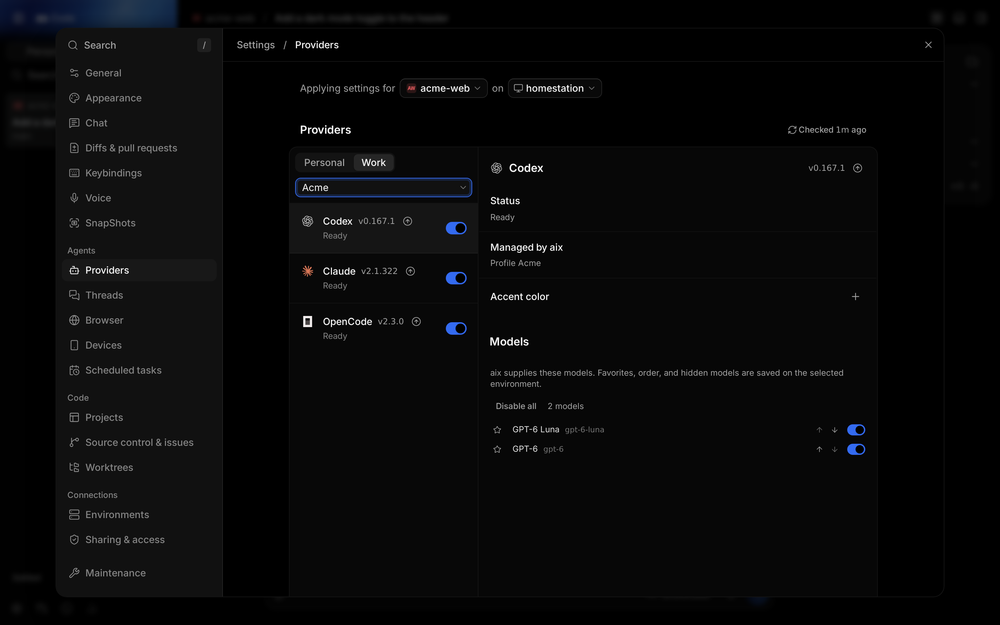

# aix profiles

[aix](https://github.com/get-aix/aix) keeps your AI gateway profiles in one place: each profile
pairs a gateway URL with an API key from your password manager or environment. This fork turns every
API-key profile in aix into ready-to-use agents in aix Code. For example, an `acme` profile labeled
**Acme** becomes three providers:

- **Acme · Claude Code** for Claude models
- **Acme · Codex** for GPT models
- **Acme · OpenCode** for every other chat model

They appear in **Work** projects alongside their gateway model catalogs, pricing, and budgets—all
read directly from aix.

<p align="center">
  
</p>

## Set up aix

1. [Install aix](https://github.com/get-aix/aix#installation) on the machine running the T3 server.
   With the desktop app, that's your computer; with a remote server, it's the server host.
2. Add an API-key profile and verify it works:

   ```sh
   aix profiles
   aix status acme
   ```

3. Restart aix Code if you installed aix while it was already running, so the server picks up `aix`
   on its `PATH`.

aix integration is enabled by default. To turn it off without uninstalling the fork, set
`T3CODE_AIX=0` on the server (or disable individual aix providers in **Settings → Providers**).

Your API keys never leave the server. T3 asks aix for a profile's endpoint and key only when
launching an agent, and never writes them to T3 settings or sends them to web, desktop, or mobile
clients.

> [!NOTE]
> ChatGPT sign-in profiles in aix aren't supported here. Keep using T3's built-in Codex provider for
> a personal ChatGPT subscription.

## Pick a model

aix models live in the **Work** scope so they stay separate from your personal subscriptions (see
[Personal and Work](./work-personal.md)).

1. Open a thread (or start a new draft) in a Work project.
2. Open the model picker under the composer.
3. Choose an aix profile in the picker's footer (for example, **Acme** or **Research Lab**).
4. Pick an agent tab (**Codex**, **Claude**, or **OpenCode**), then select a model.

<p align="center">
  
</p>

Models priced at `$0` on the gateway are marked **Free**. Press the info (**i**) button beside any
model to inspect its full details:

- **Family**, such as Claude, GPT, or Qwen
- **Context window** and **max output** in tokens
- **Input** and **output price** per million tokens
- **Reasoning levels** the model accepts
- **Exact model ID** with a copy button

Any field your gateway doesn't report shows as **Unknown**.

<p align="center">
  
</p>

New threads inherit the project's last selection and respect the project's **Work key** (see
[Work keys and approvals](./work-personal.md#work-keys-and-approvals)).

## Which agent runs a model

T3 routes each gateway model to the agent built for it:

| Model                                            | Agent       |
| ------------------------------------------------ | ----------- |
| Claude models (from a gateway or Anthropic API)  | Claude Code |
| GPT models from a LiteLLM gateway                | Codex       |
| Open-weight `gpt-oss` models                     | OpenCode    |
| Other chat models, such as Gemma, Qwen, or Llama | OpenCode    |

- A direct Anthropic API profile offers Claude models only.
- T3 configures OpenCode automatically for each aix profile—no separate OpenCode login or config
  file is needed.
- Embedding, image, audio, and wildcard routes are filtered out.
- T3 always sends the gateway the model's exact ID.

If a model or profile stops working, the turn fails with a clear error. T3 never silently swaps in a
different model or agent behind your back.

## Manage aix providers in Settings

Open **Settings → Providers**, choose **Work** at the top, and select a profile under **Work
profile** to inspect its Codex, Claude, and OpenCode instances, connection status, and models. If
you toggle an instance off, T3 remembers that choice across reloads.

<p align="center">
  
</p>

## Refresh catalogs and rotate keys

T3 loads your profiles and model catalogs through `aix models --detailed` on startup and refreshes
them daily. To pull new profiles or newly added gateway models right away:

- Press **Refresh** in the model picker next to the profile's catalog status, or
- Open the command palette (`Ctrl+K` / `⌘K`) and run **Refresh aix catalogs**.

<p align="center">
  
</p>

What happens on reload:

- **New profile:** its Codex, Claude, and OpenCode providers are created automatically.
- **Removed profile:** its providers are disabled (and come back if the profile returns, unless you
  disabled them manually).
- **Failed reload:** T3 keeps the last working catalog and marks it **Stale catalog** with the
  error.

Key rotation needs no reload. T3 resolves credentials from aix each time it launches an agent, so
the next turn automatically uses the rotated key while any in-progress turn finishes cleanly.

## Switch profile or model mid-thread

Pick a different model—from the same aix profile or another one—at any point in a thread. The next
agent receives the conversation via a [portable handoff](./portable-handoffs.md) and continues from
there without trying to resume the previous agent's native session.

If you switch while a turn is running, the new selection takes effect on your next message.

## Troubleshooting

- **No aix models in the picker:** make sure the project is in **Work** and the picker footer shows
  a profile. Then verify aix works for the user running T3 (`aix profiles` and
  `aix status <profile>`). Restart T3 if you installed aix after starting it.
- **Stale catalog or Catalog unavailable:** the last reload couldn't reach the gateway or resolve
  the key. Fix the cause shown in the message, then press **Refresh**.
- **Provider shows as unavailable in Settings:** press **Refresh provider status** in **Settings →
  Providers**. Startup probes can occasionally time out under heavy load.
- **A turn fails right away:** the model may have been removed from the gateway or the key may have
  hit its budget cap. Check the error, your key's budget on the [Usage page](./aix-budgets.md), and
  `aix status <profile>`.
