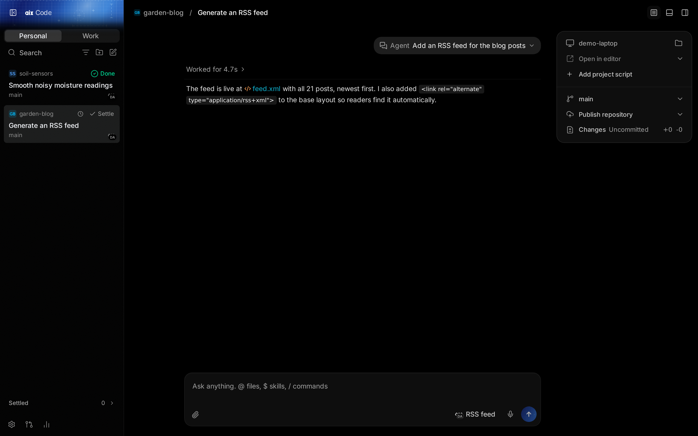
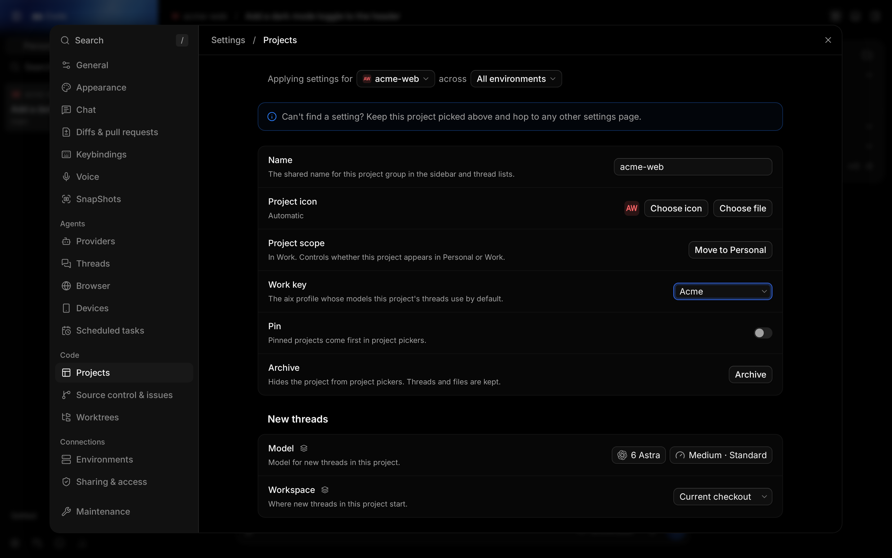
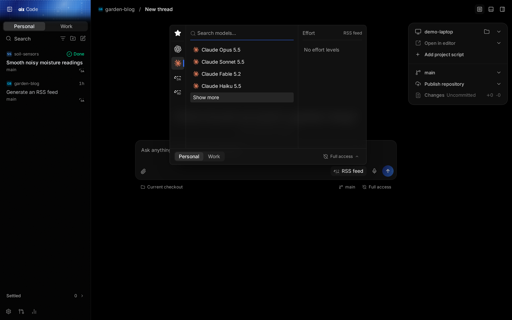

# Personal and Work

Every project in this fork belongs to either **Personal** or **Work**. The switch at the top of the
sidebar chooses which workspace you're looking at, and the rest of the app follows along:

- **Personal** shows your personal projects and your own subscriptions (such as your Claude or
  ChatGPT sign-in).
- **Work** shows work projects, your company's [aix profiles](./aix-profiles.md), Work keys, and
  gateway budgets.

Work stays on your team's gateway, and personal side projects stay on your own subscriptions—no more
accidentally burning work budget on a hobby repo or sending company code to a personal account.

  

## Switch scopes

Click the **Personal / Work** switch at the top of the sidebar to flip between scopes immediately.
Your sidebar, search results, and project pickers update right away while running turns keep going.

You can also switch from the command palette (`Ctrl+K` / `⌘K`) with **Show Work projects** or
**Show Personal projects**.

  

Each client remembers its own active scope—your desktop app can stay on **Work** while your phone
shows **Personal**.

## Move a project

Existing projects without a scope default to **Personal**, including projects from before you
installed the fork. To move a project between scopes, use any of these:

- **Sidebar:** right-click the project and choose **Move to Work** or **Move to Personal**.
- **Command palette:** run **Move project to Work** or **Move project to Personal**.
- **Project settings:** under **Project scope**, click **Move to Work** or **Move to Personal**.
- **Android app:** open the project in Settings and tap **Move to Work** or **Move to Personal**.

  

The project and all of its threads move together. A toast confirms the move with an **Undo** button
and a quick shortcut to switch into the other scope.

  

New projects automatically inherit whichever scope you're currently viewing.

## The model picker follows your scope

Open the model picker in a Work project and it opens on **Work** with your aix profiles. Open it in
a Personal project and it opens on **Personal** with your own providers.

  

The picker also includes its own **Personal / Work** toggle so you can intentionally pick a model
from the other scope for a specific thread. If a thread is already using a model from the other
scope, the picker stays on that model until you change it.

**Settings → Providers** uses the same scope toggle, plus a **Work profile** selector to inspect
each aix profile's providers. The [Usage page](./aix-budgets.md) splits Work and Personal spend the
same way.

## Work keys and approvals

Each Work project can have a **Work key**—the default [aix profile](./aix-profiles.md) that its
threads and agents are allowed to use without asking. Configure it under **Project settings → Work
key**.

Agents and threads can still use other keys or personal providers when you explicitly allow it:

- **Sending on another key:** if you send a message using a model outside the project's Work key,
  aix Code asks you to confirm first. Confirming sends the message and adds that key to the thread's
  allowed keys; cancelling leaves your draft untouched.
- **An agent requesting another key:** when an agent or subagent asks to run work on a different
  key, aix Code pauses and shows a decision card in the thread:
  - **Deny** refuses the request.
  - **Allow this task** grants a single-use approval for that one delegated run.
  - **Allow for this thread** allows that key for the rest of the thread (you can revoke it right
    from the card at any time).
- **Pre-approving keys on drafts and threads:** for unattended or multi-model runs, you can grant
  extra keys up front—even before sending your first message. Open the model picker to see **Agents
  in this thread may use**, click **Allow another key…** to add one, or **Remove** to revoke it.

## What the scope filters

The active scope filters:

- Projects and threads in the sidebar
- Thread and project search
- Project choosers (such as picking a project for a new thread)
- The model picker's starting scope
- **Settings → Providers** and the **Usage** page

It does **not** filter:

- Running turns and queued work, which continue in the background
- Notifications
- Shared preferences like theme and keyboard shortcuts

## Scopes aren't access control

A scope is an organizational label stored on the server—anyone who can connect to that server can
switch between Personal and Work. It keeps your daily workflow tidy, not your data cryptographically
isolated.

If you need hard separation, run two T3 servers with separate `T3CODE_HOME` directories (the
[Nix install guide](./install.md#aix-code-nix) shows how). One T3 client can connect to both
servers at once.

## Clients

The Personal/Work switch, Work keys, and lane approvals work on web, desktop, and the fork's
[Android app](./fork.md#the-android-app). Official upstream iOS and Android apps still connect to a
fork server and can run aix providers, but they show all projects together without the scope switch.
